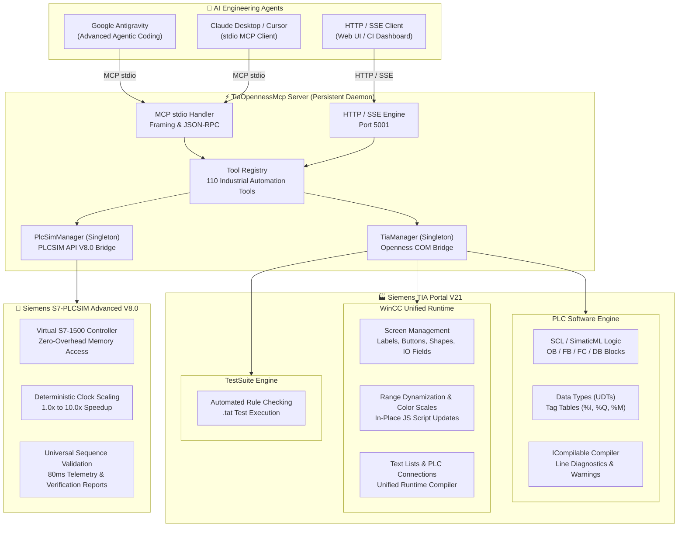
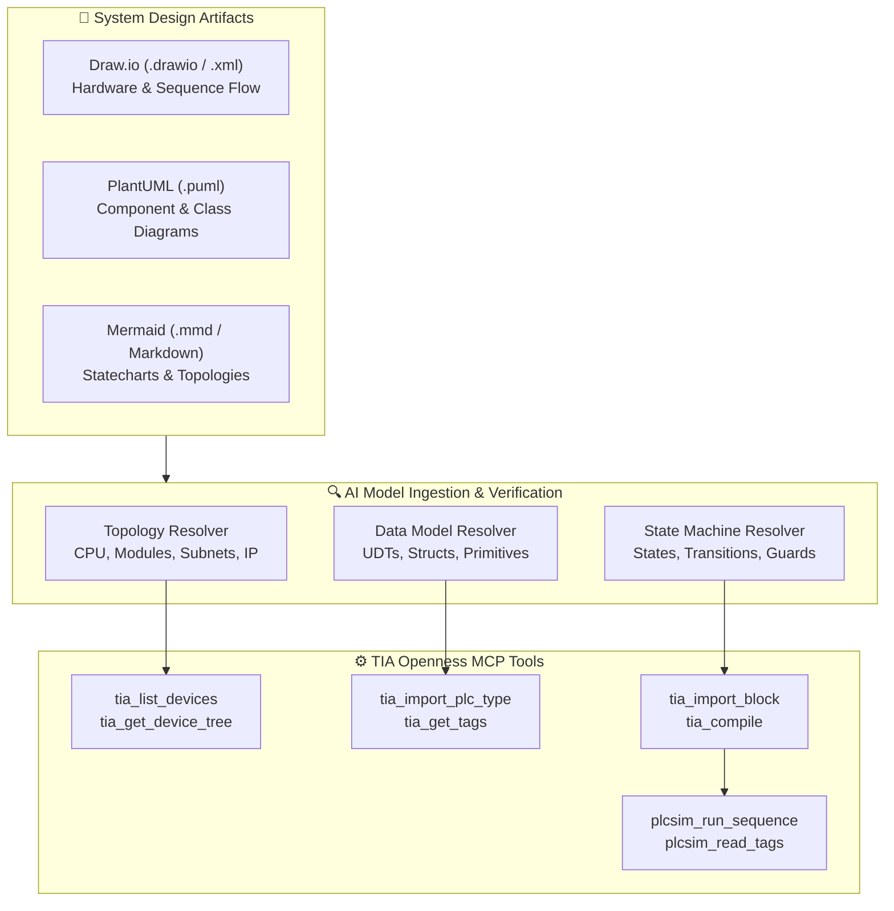
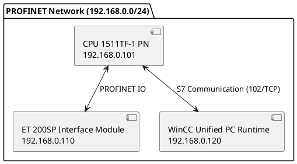
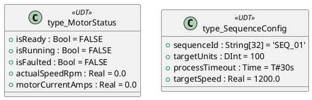
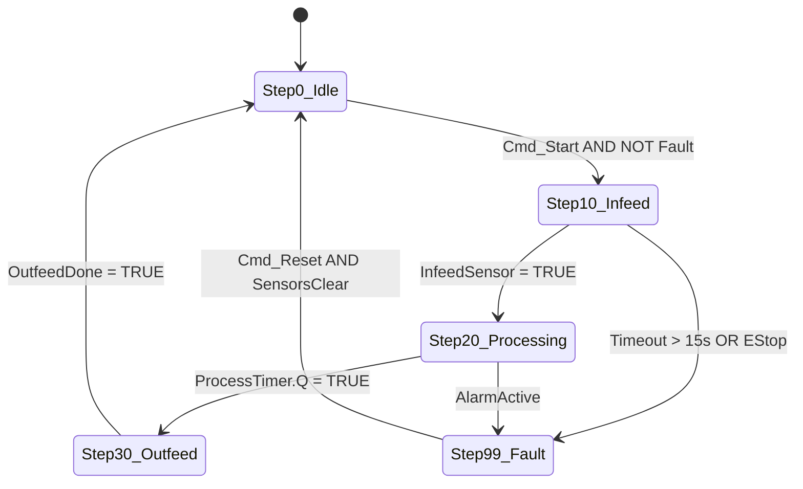
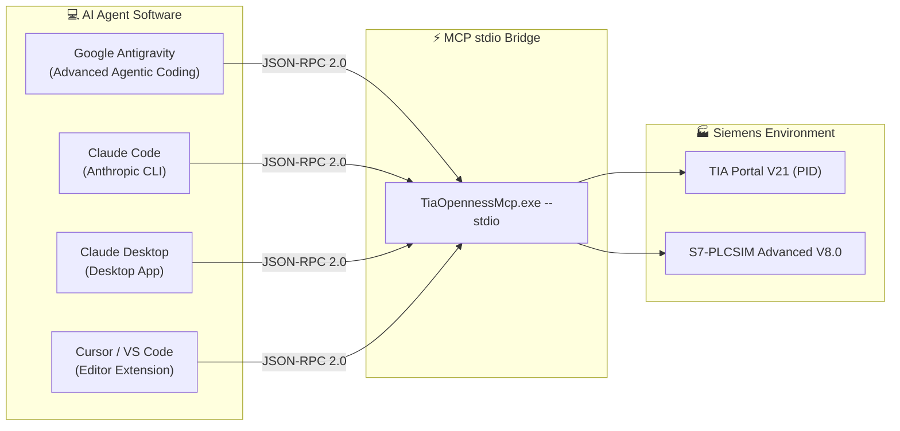

# TIA-MCP-Server: Siemens TIA Portal V21 & S7-PLCSIM Advanced Openness MCP Server

[](https://support.industry.siemens.com)
[](https://support.industry.siemens.com)
[](https://modelcontextprotocol.io)
[](https://dotnet.microsoft.com)
[](#version-history--bug-fixes)
[](#complete-tools-reference-dictionary-110-tools)
[](LICENSE)

A high-performance, persistent **Model Context Protocol (MCP)** server providing AI coding agents (such as **Google Antigravity**, **Claude Desktop**, **Cursor**, and **VS Code**) with direct programmatic control over **Siemens TIA Portal V21** and **S7-PLCSIM Advanced V8.0**.

Equipped with **110 specialized industrial automation tools**, this server bridges generative AI with deterministic industrial hardware and software—enabling automated PLC logic authoring, model-based architecture ingestion (Draw.io / PlantUML / Mermaid), automated design-to-HMI pipelines (Figma to WinCC Unified), live simulation memory I/O, and automated Hardware-in-the-Loop (HIL) sequence verification with telemetry report generation.

---

## Architecture & Technology Stack

```
 +---------------------------------------------------------------------------------------+
 |                     AI Agents / Pair Programmers (Antigravity, Claude, Cursor)        |
 +---------------------------+-------------------------------+---------------------------+
                             |                               |
               HTTP JSON-RPC | Server-Sent Events (SSE)      | Standard I/O (MCP stdio)
               POST /mcp     | GET /sse                      | stdin / stdout
                             v                               v
 +---------------------------------------------------------------------------------------+
 |                    TiaOpennessMcp Persistent Daemon (Port 5001)                       |
 |                                                                                       |
 |  [ServerConfig]                 [HttpMcpServer]              [McpServer]              |
 |  - config.json (Host/Port)      - Multi-client SSE Sessions  - stdio framing          |
 |  - AutoConnect & PID binding    - POST /mcp & /status        - stderr logging         |
 |                                                                                       |
 |  [TiaManager Singleton]                     [PlcSimManager Singleton]                 |
 |  - Persistent COM connection                - S7-PLCSIM Advanced API V8.0             |
 |  - TiaPortal & Project handles              - Shared Memory Controller Link           |
 |  - Dynamic Openness Assembly Resolver       - High-Speed Symbolic Tag Cache           |
 |  - 50 Openness Tools (PLC, HMI, TestSuite)  - 12 Virtual Simulation & Testing Tools   |
 +------------------------------+-------------------------------+------------------------+
                                |                               |
       Siemens TIA Openness COM | PublicAPI                     | Simulation Runtime API
                                v                               v
 +----------------------------------------------+ +--------------------------------------+
 |           Siemens TIA Portal V21             | |   Siemens S7-PLCSIM Advanced V8.0    |
 | - Hardware Configuration & Device Tree       | | - Virtual S7-1500 Controller (Run)   |
 | - PLC Logic (OB, FB, FC, DB, SCL, SimaticML) | | - Zero-Overhead Memory Read/Write    |
 | - WinCC Unified PC Runtime (Screens, Items)  | | - Deterministic Clock Scaling        |
 | - Siemens TestSuite Automated Rule Execution | | - Automated Online Sequence Runner   |
 +----------------------------------------------+ +--------------------------------------+
```

### Architectural Tenets:
1. **Always-On Connection Persistence (`connexion must stay`)**: TIA Portal and project instances are heavy COM entities requiring significant startup time. `TiaManager` and `PlcSimManager` maintain live handles in memory so every AI turn executes with sub-second latency without reloading the project.
2. **Dual-Transport Flexibility**: Standard MCP stdio for agent runners, alongside a concurrent HTTP/SSE daemon (port `5001`) for web interfaces, live telemetry dashboards, and multi-agent orchestrators.
3. **Clean-Room Assembly Loading**: Dynamically resolves Siemens assemblies from local installation paths (`PublicAPI\V21\net48\` and `PLCSIMADV\API\8.0\`), avoiding unauthorized binary redistribution while ensuring 100% binary compatibility with Siemens updates.

---

## Core Capabilities



### 1. TIA Portal Core & PLC Engineering (26 Tools)
- **Lifecycle & Instances**: Discover running PIDs (`tia_list_processes`), attach silently (`tia_connect`), open projects headless or with GUI (`tia_open_project`), save (`tia_save_project`), and close (`tia_close_project`).
- **Hardware Topology**: Inspect racks, subnets, slots, CPU modules, and distributed I/O stations (`tia_list_devices`, `tia_get_device_tree`).
- **Software Logic & Blocks**: Enumerate blocks with language and consistency state (`tia_list_blocks`), export block code as SimaticML XML with extracted SCL (`tia_get_block_code`), import/overwrite SimaticML (`tia_import_block`), import complete SCL source (`tia_import_scl_block`), and delete obsolete blocks (`tia_delete_block`). SCL replacement backs up and deletes the old block before importing; failed imports attempt restoration, while compile errors are reported without rollback.
- **Data Types & Tags**: Author User Data Types (`tia_list_plc_types`, `tia_import_plc_type`) and manage tag tables (`tia_list_tag_tables`, `tia_get_tags`).
- **Native Diagnostics**: Compile software containers via `ICompilable` and return exact error messages, line numbers, and warnings (`tia_compile`).

### 2. WinCC Unified HMI Engineering (49 Tools)
- **Screen Management**: Create and delete Unified screens, and list or target screens recursively through nested screen groups (`hmi_list_screens`, `hmi_create_screen`, `hmi_delete_screen`).
- **Widgets & UI Elements**: Programmatically position labels with HTML typography (`hmi_add_label`), pushbuttons (`hmi_add_button`), tag-bound toggle switches (`hmi_add_toggle_switch`), geometric shapes (`hmi_add_shape`), and process I/O fields (`hmi_add_io_field`).
- **Discrete Alarms**: Create or update discrete alarms with validated trigger tags, alarm classes, trigger modes, and multilingual event text (`hmi_create_discrete_alarm`).
- **Range Dynamization**: Dynamize properties (e.g. `BackColor`, font color) to integer/real tags using `ConditionType.Range` (`hmi_set_tag_dynamization`).
- **Mapping Entry Updates**: Update an existing tag or expression dynamization entry's value, alternate value, or flashing settings in place (`hmi_update_dynamization_entry`).
- **Expression Condition Rows**: Replace ordered Expressions-tab conditions and their typed property values in place (`hmi_set_expression_dynamization_entries`).
- **In-Place Script Updates**: Safely update button JavaScript handlers in-place without deleting or disrupting layout coordinates (`hmi_update_button_scripts`).
- **JSON-Based HMI Engineering**: Export, import, and patch screens, tags, and discrete alarms using versioned `tia-mcp-hmi/1` JSON files (`hmi_export_json`, `hmi_read_export_file`, `hmi_begin_import`, `hmi_upload_import_file`, `hmi_import_json`, `hmi_patch_json`). Remote clients can transfer files through bounded Base64 chunks. Imports are transactional, verified, compiled, and never save the project.
- **Communication & Text Lists**: Create device-level text lists (`hmi_create_text_list`), export text lists (`hmi_export_text_lists`), and establish HMI-to-PLC communication links (`hmi_create_connection`).
- **Compile Diagnostics**: Full Unified runtime compilation diagnostics with item-level error reporting (`hmi_compile`).

HMI JSON exports are organized as `manifest.json`, `screens/`, `tags/`, `alarms/discrete.json`, and optional shared `styles.json`. File hashes are verified by default on import; use `verify_hashes: false` only when intentionally editing exported files without updating their manifest hashes. Imports support a dry run and optional item pruning; patch files support guarded set/bind/delete operations and verification requirements.

Tag and Expression dynamizations preserve value converters and typed Simple/Range/Bitmask mappings.
Faceplates retain their contained-type identity; internal tags retain their data type and unset limits.
Custom widgets export supported full properties but must already exist when importing; their
interfaces and complex control compositions are not serialized. Inspect manifest warnings;
the JSON export is not a complete project backup. Unsupported dynamizations and tag-based
limits fail explicitly.

#### Offline screen rendering for AI layout review

`hmi_render_json` renders an exported directory without connecting to TIA Portal or
executing JavaScript, expressions, or tag reads. The equivalent Windows CLI is:

```powershell
.\src\bin\Debug\net48\TiaOpennessMcp.exe --render-hmi C:\Projects\Plant\hmi\HMI_RT_1 --output C:\Projects\Plant\previews --language en-US --scale 2
# Optional: --screen ParameterScreen (or group/name to disambiguate).
```

Each screen produces a clean lossless `.png`, a numbered `.layout.png`, and a
`.layout.json` containing matching IDs, item paths, z-order, screen-space bounds,
visibility, clipping, possible text overflow, placeholders, and unresolved dynamic
properties. `render-index.json` links the results. Default scale is 2x for readable
AI inspection; coordinates in reports remain unscaled screen pixels. Review the
clean image first, then use overlay IDs and JSON to locate layout problems precisely.

The renderer resolves shared styles, localized text/markup, rounded shapes, lines,
buttons, IO fields, and static nested screen windows (including clipping, zoom, and
scroll offsets). Dynamic process values are shown as `?`. Default language is `en-US`
when available, otherwise the first manifest language. Explicitly select a language
for reproducible review. Output files are never overwritten.

New compact exports include a hashed `defaults.json` referenced by `defaultsFile`,
so omitted properties can be resolved offline. Old compact exports still render,
but emit an approximation warning; prefer a full export or re-export for exact defaults.
These captured defaults are preview metadata; imports still use the destination TIA's
own type defaults.

**Fidelity limits:** this is an engineering preview, not a runtime screenshot.
Faceplates, custom SVG/widgets, alarm/trend controls, and other unavailable control
compositions are hatched placeholders. Graphic assets are not present in the export.
Missing fonts, inline rich-text formatting, window adaption/chrome, switch skins,
fill patterns and compositing approximations are disclosed in each report. Install
the original fonts for reliable text metrics. `textOverflow` is a heuristic, not a
runtime compiler verdict. Use runtime validation for final visual sign-off.

### 3. Project, Library & Text Discovery (6 Tools)
- **Libraries**: Enumerate global libraries and search project-library types or faceplates using bounded results and exact open-project scope; discover PLC instances of exact project-library types.
- **Project Texts**: Discover project text categories and export project texts using explicit cultures without overwriting an existing file.

### 4. PLC, Project & HMI Operations (15 Tools)
- **Read-only PLC Data**: Inspect exact tag/member/table attributes and user-constant type/value data with exact PLC/table/group resolution.
- **PLC Structure & Constants**: Create block/tag-table groups and tag tables, and create/update supported user constants with exact target resolution and read-back.
- **Project Setup**: Create a project only in an existing empty directory using the connected TIA Portal instance.
- **HMI Structure & Navigation**: Create screen groups/screens, add verified navigation buttons, and rename screens, groups, or tag tables in place with explicit fail-on-conflict behavior.
- **Verification**: Each mutation has a case-by-case disposable-project test plan; live TIA verification remains for the operator.

### 5. S7-PLCSIM Advanced Live Simulation & Testing (12 Tools)
- **Direct Runtime Link**: Connects to virtual S7-1500 controllers via shared memory API V8.0 (`plcsim_connect`).
- **Operating Modes**: Query status (`plcsim_get_status`) and switch CPU operating modes (`plcsim_set_operating_state`: `Run`, `Stop`, `MemoryReset`).
- **Clock Scaling**: Accelerate simulation deterministically (`plcsim_set_scale_factor`: e.g. `2.0x` or `5.0x` speed).
- **Zero-Overhead Memory I/O**: High-speed symbolic tag reading and writing (`plcsim_read_tag`, `plcsim_write_tag`, `plcsim_read_tags`, `plcsim_write_tags`).
- **Universal Sequence Validation**: Execute parameterized sequence tests on any state machine (`plcsim_run_sequence`), sample 80ms telemetry, verify state transitions, and generate validation reports.

### 6. Siemens TestSuite Automation (2 Tools)
- Enumerate configured project test cases (`tia_testsuite_list_tests`).
- Import and reload `.tat` rule files with `ImportOptions.Override` (`tia_testsuite_load_test`).

---

## Figma to WinCC Unified Workflow

The MCP server enables an automated **Design-to-Industrial HMI** pipeline, transforming UI/UX designs into production-ready WinCC Unified V21 screens.

```mermaid
flowchart LR
    Figma["🎨 Figma Design<br/>(Frames, Tokens, SVGs)"] -->|Export JSON & Vectors| Ingestion["🤖 AI Agent Ingestion<br/>(Geometry & Token Mapping)"]
    Ingestion -->|hmi_create_screen & hmi_add_*| Creation["🖥️ WinCC Unified Screens<br/>(Widgets, Shapes, IO Fields)"]
    Creation -->|hmi_set_tag_dynamization| Dynamization["⚡ Range Dynamization<br/>(Multi-state Color Feedback)"]
    Dynamization -->|hmi_update_button_scripts| Scripting["📜 In-Place Scripting<br/>(Safe JavaScript Handlers)"]
    Scripting -->|hmi_compile| Compilation["✅ Unified Compiler<br/>(Zero Error Verification)"]
```



### Pipeline Stages:
1. **Design & Token Export (Figma)**:
   - Designers organize screens in Figma frames with layout grids (e.g. 1920x1080 or custom industrial aspect ratios).
   - Component tokens are exported (geometry: `x`, `y`, `width`, `height`; styles: background fill, borders, typography; vector graphics as SVGs).
2. **AI Agent Ingestion & Translation**:
   - The AI agent parses design coordinates and converts CSS/hex colors into WinCC Unified ARGB format (`#AARRGGBB` or `#RRGGBB`).
   - Figma visual elements map directly to native WinCC Unified primitives:
     - Text frames $\rightarrow$ `hmi_add_label` (with embedded HTML formatting).
     - Rectangles / Cards / Containers $\rightarrow$ `hmi_add_shape` (`Rectangle`).
     - Action elements $\rightarrow$ `hmi_add_button`.
     - Data displays & entry $\rightarrow$ `hmi_add_io_field` (bound to PLC tags).
3. **Screen Creation & Placement**:
   - Creates targeted screen: `hmi_create_screen` (e.g. `MainOperation`, `Diagnostics`).
   - Populates screen widgets with exact pixel coordinates.
4. **Range Dynamization & Color States**:
   - Binds visual attributes (such as background color) to PLC status tags using `hmi_set_tag_dynamization`.
   - Supports multi-level range mapping (e.g. `0..0: Stopped (#6C757D)`, `10..50: Running (#28A745)`, `99..99: Fault (#DC3545)`).
5. **In-Place Script Updates**:
   - Injects JavaScript event handlers via `hmi_update_button_scripts`.
   - Modifies existing buttons in-place without widget re-creation, preserving all coordinate bindings and visual stacking order.
6. **Unified Runtime Verification**:
   - Validates the resulting screen via `hmi_compile`, returning compilation diagnostics directly to the agent.

---

## Model-Based Engineering: UML & Architecture Ingestion

The MCP server accepts structured system models to synthesize hardware configuration, PLC User Data Types (UDTs), and state machine logic directly from engineering diagrams.



### 1. Hardware Topology Ingestion (Component / Deployment Diagrams)
The server expects architecture diagrams detailing:
- **Controller Module**: Family, CPU catalog number (e.g. `CPU 1511TF-1 PN`, `6ES7 511-1TK01-0AB0`), firmware version.
- **Network Interfaces**: PROFINET / Industrial Ethernet subnets, station names, IP addresses, and subnet masks.
- **Distributed I/O**: Rack/slot assignments, I/O module order numbers (e.g. digital inputs, analog outputs, motion modules).

#### Expected Ingestion Format (Example: PlantUML Component Diagram):


### 2. Data Types & UDTs Ingestion (Class / Structure Diagrams)
For software data models, the server expects structured types specifying field names, primitive or composite data types, default initial values, and engineering comments.

#### Expected Ingestion Format (Example: Draw.io / PlantUML Class Diagram):

*The agent translates these structures directly into SimaticML XML definitions and invokes `tia_import_plc_type`.*

### 3. State Machines & Sequences Ingestion (Statechart Diagrams)
To generate deterministic sequence blocks, provide a statechart defining:
- **States & Step Numbers**: Explicit integer indexing (e.g. `0: IDLE`, `10: INFEED`, `20: PROCESSING`, `30: OUTFEED`, `99: FAULT`).
- **Guards & Conditions**: Explicit boolean conditions or sensor thresholds required to transition.
- **Actions**: Outputs activated in each state.
- **Timeouts & Abort Paths**: Maximum duration per state before triggering alarm/recovery.

#### Expected Ingestion Format (Example: Mermaid Statechart):

*The agent generates structured IEC 61131-3 SCL `CASE currentStep OF ... END_CASE;` logic, imports it via `tia_import_block`, compiles via `tia_compile`, and validates execution live in S7-PLCSIM Advanced via `plcsim_run_sequence`.*

---

## Complete Tools Reference Dictionary (110 Tools)

| # | Tool Name | Category | Primary Parameters | Description |
|:---:|:---|:---:|:---|:---|
| 1 | `tia_get_status` | Connection | *(none)* | Live connection status, attached PID, and open project metadata. |
| 2 | `tia_list_processes` | Connection | *(none)* | Enumerate all running TIA Portal instances. |
| 3 | `tia_connect` | Connection | `process_id` (opt) | Attach to a running TIA Portal instance. |
| 4 | `tia_disconnect` | Connection | *(none)* | Detach from active TIA Portal instance. |
| 5 | `tia_get_project_info` | Connection | *(none)* | Project metadata (author, path, modified timestamp). |
| 6 | `tia_open_project` | Connection | `project_path`, `with_gui` | Open a `.ap21` or `.ap20` project file. |
| 7 | `tia_save_project` | Connection | *(none)* | Save modifications to open project. |
| 8 | `tia_close_project` | Connection | *(none)* | Close current project. |
| 9 | `tia_list_devices` | Hardware | *(none)* | List all physical and logical devices. |
| 10 | `tia_get_device_tree` | Hardware | `device_name` | Inspect device slots, modules, and subnets. |
| 11 | `tia_list_plcs` | PLC Logic | *(none)* | Summary of all PLCs and software counts. |
| 12 | `tia_list_blocks` | PLC Logic | `plc_name`, `block_type`, `folder` | Enumerate OB, FB, FC, and DB blocks with language & status. |
| 13 | `tia_get_block_code` | PLC Logic | `block_name`, `plc_name` | Export block as SimaticML XML & extract SCL. |
| 14 | `tia_import_block` | PLC Logic | `xml_content`, `plc_name`, `overwrite` | Import or update block logic via SimaticML XML. |
| 14a | `tia_import_scl_block` | PLC Logic | `scl_code`, `plc_name`, `folder`, `compile_after_import`, `open_after_import` | Import a complete SCL block; replacement uses backup/delete/reimport with restore on import failure. |
| 15 | `tia_delete_block` | PLC Logic | `block_name`, `plc_name` | Delete a PLC program block. |
| 16 | `tia_list_plc_types` | Data Types | `plc_name` | List all User Data Types (UDTs). |
| 17 | `tia_get_plc_type` | Data Types | `type_name`, `plc_name` | Export UDT definition as SimaticML XML. |
| 18 | `tia_import_plc_type` | Data Types | `xml_content`, `plc_name`, `overwrite` | Import or update a UDT definition. |
| 19 | `tia_compile` | Compilation | `plc_name` | Compile PLC software & return error diagnostic log. |
| 20 | `hmi_list_targets` | HMI Runtime | *(none)* | List all HMI software instances (e.g. `PC-System_1/HMI_RT_1`). |
| 21 | `hmi_list_screens` | HMI Screen | `target_name` (opt) | List all screens with resolution and item counts. |
| 22 | `hmi_create_screen` | HMI Screen | `screen_name`, `width`, `height` | Create a new WinCC Unified screen. |
| 23 | `hmi_delete_screen` | HMI Screen | `screen_name` | Delete a screen from HMI software. |
| 24 | `hmi_get_screen_items` | HMI Screen | `screen_name` | Retrieve all screen widgets, coordinates, and scripts. |
| 25 | `hmi_delete_screen_items` | HMI Screen | `screen_name`, `item_names`, `prefix` | Delete specific screen widgets. |
| 26 | `hmi_add_label` | HMI Widget | `screen_name`, `name`, `text`, `left`, `top` | Add HTML-formatted text label with typography controls. |
| 27 | `hmi_add_button` | HMI Widget | `screen_name`, `name`, `text`, `script` | Add pushbutton with OnClick JavaScript script. |
| 28 | `hmi_add_toggle_switch` | HMI Widget | `screen_name`, `name`, `off_text`, `on_text`, `process_tag` | Add a two-state toggle bound to `IsAlternateState`. |
| 29 | `hmi_add_shape` | HMI Widget | `screen_name`, `type`, `width`, `height` | Add rectangle or circle with border and fill styling. |
| 30 | `hmi_add_io_field` | HMI Widget | `screen_name`, `name`, `process_value_tag` | Add numeric/string Input-Output field bound to tag. |
| 31 | `hmi_set_tag_dynamization`| HMI Logic | `screen_name`, `item_name`, `ranges` | Bind property (e.g. `BackColor`) to tag using Range entries. |
| 32 | `hmi_update_dynamization_entry` | HMI Logic | `screen_name`, `item_name`, `property_name`, `entry_index` | Update selected mapping-entry values or flashing settings in place. |
| 33 | `hmi_update_button_scripts`| HMI Logic | `screen_name`, `button_name`, `script` | Update existing button scripts **in-place** with JS validation. |
| 34 | `hmi_list_tag_tables` | HMI Tags | `target_name` (opt) | List HMI tag tables. |
| 35 | `hmi_list_tags` | HMI Tags | `table_name` | List HMI tags with data types and connection bindings. |
| 36 | `hmi_create_tag` | HMI Tags | `table_name`, `tag_name`, `connection` | Create HMI tag mapped to PLC address. |
| 37 | `hmi_create_discrete_alarm` | HMI Alarms | `alarm_name`, `alarm_class`, `raised_state_tag`, `text` | Create a discrete alarm from an existing HMI trigger tag. |
| 38 | `hmi_update_tag_acquisition_cycles` | HMI Tags | `tags` | Configure acquisition cycle rate (e.g. 100ms, 1s). |
| 39 | `hmi_set_tag_range` | HMI Tags | `table_name`, `tag_name`, `min`, `max` | Configure linear limits and scaling. |
| 40 | `hmi_create_data_log` | HMI Logging | `log_name`, `max_size_mb` | Create historical circular data log. |
| 41 | `hmi_assign_logging_tags` | HMI Logging | `log_name`, `tag_names` | Assign process tags to historical archive. |
| 42 | `hmi_list_connections` | HMI Comm | `device_name` (opt) | Enumerate all configured HMI communication links. |
| 43 | `hmi_create_connection` | HMI Comm | `connection_name`, `plc_device_name` | Create a communication link between HMI and PLC. |
| 44 | `hmi_delete_connection` | HMI Comm | `connection_name` | Remove an HMI communication link. |
| 45 | `hmi_list_text_lists` | HMI Text | `device_name` (opt) | Enumerate all text and graphic lists. |
| 46 | `hmi_create_text_list` | HMI Text | `name`, `list_type`, `entries` | Create value or range text list (e.g. status decoders). |
| 47 | `hmi_delete_text_list` | HMI Text | `name` | Remove a text list. |
| 48 | `hmi_export_text_lists` | HMI Text | `destination_folder`, `base_filename`| Export text lists to `.hmi.yml` files. |
| 49 | `hmi_compile` | Compilation | `target_name` | Compile WinCC Unified runtime with diagnostics. |
| 50 | `tia_list_tag_tables` | PLC Tags | `plc_name` | List PLC tag tables. |
| 51 | `tia_get_tags` | PLC Tags | `table_name`, `plc_name` | Read PLC tags with `%I`, `%Q`, `%M` addresses. |
| 52 | `hmi_export_json` | HMI JSON | `output_directory` (optional), `compact`, `script_files`, `target_name` | Export versioned, hashed JSON files; omit destination for remote transfer. |
| 53 | `hmi_import_json` | HMI JSON | `input_directory` or `transfer_id`, `prune_items`, `dry_run`, `verify_hashes`, `target_name` | Validate and transactionally import HMI JSON; compile without saving. |
| 54 | `hmi_patch_json` | HMI JSON | `file_path`, `dry_run`, `target_name` | Apply a guarded JSON patch to Unified HMI objects. |
| 55 | `tia_testsuite_list_tests`| TestSuite | `plc_name` | List configured Siemens TestSuite test cases. |
| 56 | `tia_testsuite_load_test`| TestSuite | `file_path` | Import or reload `.tat` rule file with override. |
| 57 | `plcsim_list_instances` | Simulation | *(none)* | List all registered S7-PLCSIM Advanced instances. |
| 58 | `plcsim_connect` | Simulation | `instance_name` (default `"PLC_1"`) | Connect to S7-PLCSIM Advanced and cache symbolic tags. |
| 59 | `plcsim_disconnect` | Simulation | *(none)* | Detach from active PLCSIM instance. |
| 60 | `plcsim_get_status` | Simulation | *(none)* | Real-time status (Run/Stop, scale factor, tag counts). |
| 61 | `plcsim_set_operating_state` | Simulation | `state` (`"Run"`, `"Stop"`, `"MemoryReset"`) | Switch virtual controller operating state. |
| 62 | `plcsim_set_scale_factor` | Simulation | `scale_factor` (e.g. `2.0`) | Scale simulation clock to speed up execution. |
| 63 | `plcsim_read_tag` | Live I/O | `tag_name` | Read live DB, I, Q, or M variable by symbolic name. |
| 64 | `plcsim_write_tag` | Live I/O | `tag_name`, `value` | Write live value to variable in virtual PLC memory. |
| 65 | `plcsim_read_tags` | Live I/O | `tag_names` | Bulk read multiple variables in a single call. |
| 66 | `plcsim_write_tags` | Live I/O | `tags` (key-value object) | Bulk write multiple variables in a single call. |
| 67 | `plcsim_run_sequence` | Verification | `start_command_tag`, `step_number_tag`, `done_tag`, ... | Universal automated sequence testing for any state machine. |
| 68 | `plcsim_run_mixing_sequence`| Verification | Recipe parameters, `scale_factor` | Automated multi-parameter batch testing runner. |
| 69 | `hmi_render_json` | HMI Preview | `input_directory`, `output_directory`, `screen_name`, `language`, `scale` | Offline PNGs, numbered overlays, and layout reports with nested screens. |
| 70 | `hmi_read_export_file` | HMI JSON | `transfer_id`, `relative_path`, `offset`, `chunk_bytes` | Fetch a staged export file in bounded Base64 chunks. |
| 71 | `hmi_begin_import` | HMI JSON | *(none)* | Create a staged remote HMI JSON import. |
| 72 | `hmi_upload_import_file` | HMI JSON | `transfer_id`, `relative_path`, `content_base64`, `offset`, `total_bytes` | Upload a file in bounded sequential Base64 chunks. |
| 73 | `hmi_get_screen_item` | HMI Screen | `screen_name`, `item_name` | Read all supported properties, event scripts, and full dynamization state for one item. |
| 74 | `hmi_update_screen_item` | HMI Screen | `screen_name`, `item_name`, `item_properties` | Update allowlisted item properties in place and verify readback. |
| 75 | `hmi_read_event_scripts` | HMI Logic | `screen_name`, `item_name` (opt) | Read screen or item event scripts and supported event names. |
| 76 | `hmi_set_event_script` | HMI Logic | `screen_name`, `event_type`, `script`, `item_name` (opt) | Create or update one screen/item event script in place. |
| 77 | `hmi_set_expression_dynamization` | HMI Logic | `screen_name`, `item_name`, `property_name`, `expression`, `result_type` | Set an expression formula while preserving existing mappings and other dynamizations. |
| 78 | `hmi_get_js_type_definitions` | HMI Logic | *(none)* | Return the server-bundled, documented subset of WinCC Unified JavaScript declarations. |
| 79 | `hmi_set_expression_dynamization_entries` | HMI Logic | `screen_name`, `item_name`, `property_name`, `entries` | Replace ordered condition/value rows for one expression dynamization. |
| 80 | `tia_import_scl_block` | PLC Import | `scl_code`, `plc_name`, `folder`, `compile_after_import`, `open_after_import` | Import a complete SCL block with backup/restore behavior for same-name blocks. |
| 81 | `hmi_delete_dynamization` | HMI Logic | `screen_name`, `item_name`, `property_name`, `target_name` | Delete one property dynamization in place without replacing the item. |
| 82 | `tia_get_block_info` | PLC Discovery | `block_name`, `plc_name`, `group_path` | Read exact block identity and verified metadata without fabricating IDs or revisions. |
| 83 | `tia_get_block_attributes` | PLC Discovery | `block_name`, `plc_name`, `group_path` | Read supported consistency/protection attributes with per-attribute status. |
| 84 | `tia_get_tag_table_info` | PLC Discovery | `table_name`, `plc_name`, `group_path` | Read exact table scope and contained-tag count. |
| 85 | `tia_get_type_info` | PLC Discovery | `type_name`, `plc_name`, `group_path` | Read exact PLC type identity and verified consistency metadata. |
| 86 | `tia_get_type_attributes` | PLC Discovery | `type_name`, `plc_name`, `group_path` | Read the verified PLC type consistency attribute. |
| 87 | `tia_list_global_libraries` | Library Discovery | `name_filter`, `offset`, `page_size` | List accessible global-library metadata with bounded paging. |
| 88 | `tia_search_project_library_types` | Library Discovery | `project_path`, `query`, `offset`, `page_size` | Search project-library types within one exact open project. |
| 89 | `tia_list_project_faceplates` | Library Discovery | `project_path`, `name_filter`, `offset`, `page_size` | List faceplate library types visible in the selected project library. |
| 90 | `tia_list_project_text_categories` | Project Text | `project_path`, `query`, `offset`, `page_size` | List project text category identifiers and names. |
| 91 | `tia_download_project_texts` | Project Text | `project_path`, `destination_file_path`, `primary_culture`, `reference_culture` | Export to a new file without overwriting existing output. |
| 92 | `hmi_list_screen_groups` | HMI Discovery | `target_name` | List the selected HMI's nested screen groups and direct screen counts. |
| 93 | `hmi_list_graphic_lists` | HMI Discovery | `target_name` | List graphic-list names without claiming entry or asset coverage. |
| 94 | `tia_create_plc_tag_table` | PLC Mutation | `table_name`, `plc_name`, `group_path` | Create a tag table in an exact PLC group without overwriting. |
| 95 | `tia_create_tagtable_group` | PLC Mutation | `group_name`, `plc_name`, `parent_group_path` | Create a tag-table group at an exact path. |
| 96 | `tia_create_user_constant` | PLC Mutation | `table_name`, `constant_name`, `data_type`, `value` | Create a validated supported user constant. |
| 97 | `tia_update_user_constant` | PLC Mutation | `table_name`, `constant_name`, `value` | Update only an existing user constant's value. |
| 98 | `tia_create_project` | Project Mutation | `destination_location`, `project_name` | Create a project in an existing empty directory. |
| 99 | `hmi_create_screen_group` | HMI Mutation | `group_name`, `parent_group_path`, `on_conflict` | Create a screen group with fail-on-conflict behavior. |
| 100 | `hmi_create_screen_under_group` | HMI Mutation | `parent_group_path`, `screen_name`, `on_conflict` | Create a screen inside an existing group. |
| 101 | `hmi_rename_screen` | HMI Mutation | `screen_name`, `group_path`, `new_name`, `on_conflict` | Rename a screen in place. |
| 102 | `hmi_rename_screen_group` | HMI Mutation | `group_path`, `new_name`, `on_conflict` | Rename a screen group in place. |
| 103 | `hmi_rename_tag_table` | HMI Mutation | `table_name`, `new_name`, `on_conflict` | Rename an HMI tag table in place and verify its tag set. |
| 104 | `tia_get_plc_tag_info` | PLC Read | `tag_name`, `table_name`, `plc_name`, `group_path` | Read exact tag type, address, comment, and table scope. |
| 105 | `tia_read_user_constant` | PLC Read | `constant_name`, `plc_name`, `table_name`, `group_path` | Read a constant's type and literal, rejecting ambiguous matches. |
| 106 | `tia_create_block_group` | PLC Mutation | `group_name`, `plc_name`, `parent_group_path` | Create a block group under an exact parent path. |
| 107 | `tia_get_tag_table_attributes` | PLC Read | `table_name`, `plc_name`, `group_path` | Read API-reported tag-table attributes and values. |
| 108 | `hmi_create_navigation_button` | HMI Mutation | `target_name`, `screen_name`, `item_name`, `text`, `destination_screen`, `left`, `top`, `width`, `height`, `on_conflict` | Create a button with an explicit screen-navigation action. |
| 109 | `tia_get_library_type_instances` | Library Read | `project_path`, `plc_name`, `library_type_id`, `version_id`, `source_library` | List instances of an exact project-library type in one PLC scope. |
| 110 | `tia_get_db_member_attributes` | PLC Read | `db_name`, `member_name`, `plc_name`, `group_path` | Read V21-reported attributes for one direct global-DB member. |

---

## Universal Sequence Testing & Verification Workflow

The MCP server provides automated online sequence validation against S7-PLCSIM Advanced controllers. The tool `plcsim_run_sequence` applies to **any industrial sequence** (assembly lines, batch processing, packaging machinery, pick-and-place, stamping, motion indexing).

### Tool Invocation Example:
```json
{
  "sequence_name": "AssemblyCycle_Stage1",
  "start_command_tag": "DB_Sequence.cmdStart",
  "reset_command_tag": "DB_Sequence.cmdReset",
  "step_number_tag": "DB_Sequence.currentStep",
  "step_name_tag": "DB_Sequence.currentStepName",
  "done_tag": "DB_Sequence.isDone",
  "fault_tag": "DB_Sequence.isFault",
  "idle_step": 0,
  "parameter_tags": {
    "DB_Sequence.config.targetSpeed": 1200.0,
    "DB_Sequence.config.targetCount": 50
  },
  "monitored_tags": [
    "DB_Sequence.actualSpeed",
    "DB_Sequence.currentCount",
    "DB_Sequence.motorCurrent"
  ],
  "scale_factor": 2.0,
  "timeout_seconds": 60
}
```

### Sample Automated Verification Report:
```markdown
# S7-PLCSIM Advanced Sequence Verification Report

> **Target Controller**: `PLC_1` (CPU: `CPU1511TF`, IP: `192.168.0.101`)  
> **Sequence Tested**: `AssemblyCycle_Stage1` | **Status**: ✅ **PASS**

| Phase / Step # | Step Name | Duration (s) | Monitored Tag Mean | Peak Value | Result |
|:---:|:---|:---:|:---:|:---:|:---:|
| Step 0 | `IDLE` | 0.20 s | 0.0 RPM | 0.0 A | ✅ PASS |
| Step 10 | `PREPARATION` | 1.85 s | 250.4 RPM | 4.2 A | ✅ PASS |
| Step 20 | `ACTIVE_PROCESSING`| 5.40 s | 1200.1 RPM | 11.8 A | ✅ PASS |
| Step 30 | `TRANSFER_COMPLETION`| 2.10 s | 120.0 RPM | 3.1 A | ✅ PASS |
| Step 0 | `IDLE` | -- | 0.0 RPM | 0.0 A | ✅ PASS |
```

---

## Getting Started

### 1. Prerequisites
- **Operating System**: Windows 10/11 x64 or Windows Server 2022.
- **Siemens TIA Portal**: V21 installed with Openness option enabled.
- **S7-PLCSIM Advanced**: V8.0 (required for live virtual controller I/O and sequence testing).
- **Runtime**: .NET Framework 4.8 (pre-installed on Windows 10/11).

### 2. Standalone Release (No Build Required)
A pre-compiled, self-contained release package is available directly in the [`release/`](release/) folder:
- **`release/TiaOpennessMcp.exe`**: Pre-built executable (.NET Framework 4.8 x64).
- **`release/config.json`**: Server configuration file.
- **`release/register-whitelist.ps1`**: PowerShell script to authorize Openness access.
- **Dependency DLLs**: All required runtime libraries bundled.

### 3. Building from Source (Optional)
If you wish to modify or build the server yourself:
```powershell
git clone https://github.com/dodup/TIA-MCP-Server.git
cd TIA-MCP-Server\src
dotnet build -c Release
```
Output binary: `src\bin\Release\net48\TiaOpennessMcp.exe`.

From the repository root, validate generated MCP schemas without connecting to TIA Portal:
```powershell
.\scripts\Test-ToolSchemas.ps1 -ExecutablePath .\src\bin\Release\net48\TiaOpennessMcp.exe
```
This checks that every array parameter declares an `items` schema and that its item definition matches the checked-in schema. After updating the server binary, restart the MCP server/client connection to reload the tool definitions.

The Siemens-facing read tools have per-case plans for [PLC metadata](docs/MCP_TOOL_TEST_PLAN_PLC.md), [PLC tag and constant reads](docs/MCP_TOOL_TEST_PLAN_PLC_READS.md), [DB-member attributes](docs/MCP_TOOL_TEST_PLAN_PLC_SLICE_READS.md), [tag-table attributes and block groups](docs/MCP_TOOL_TEST_PLAN_PLC_GROUP_ATTRIBUTES.md), [library-type instances](docs/MCP_TOOL_TEST_PLAN_LIBRARY_TYPE_INSTANCES.md), [project/library/text discovery](docs/MCP_TOOL_TEST_PLAN_PROJECT.md), and [HMI discovery](docs/MCP_TOOL_TEST_PLAN_HMI.md). Mutation tools have separate plans for [PLC mutations](docs/MCP_TOOL_TEST_PLAN_PLC_MUTATIONS.md), [project creation](docs/MCP_TOOL_TEST_PLAN_PROJECT_MUTATIONS.md), [PLC group operations](docs/MCP_TOOL_TEST_PLAN_PLC_GROUP_ATTRIBUTES.md), [HMI structure](docs/MCP_TOOL_TEST_PLAN_HMI_STRUCTURE.md), and [HMI navigation buttons](docs/MCP_TOOL_TEST_PLAN_HMI_NAVIGATION.md). Project-text reads, PLC text-list discovery, library-type instantiation, and HMI template creation remain deferred with acceptance cases in their respective plans. No live tests were run for these slices.

Run HMI JSON regression checks after building (Debug by default):
```powershell
.\scripts\Test-HmiJson.ps1
.\scripts\Test-HmiRenderer.ps1
# Optional live tests: select the exact open project PID and target, and explicitly authorize temporary objects.
.\scripts\Test-HmiJson.ps1 -TiaProcessId 12345 -TargetName HMI_RT_1 -AllowRollbackTests
```
The live tests clone item types, bindings/converters, and scripts into a temporary screen,
check internal tags, and verify rollback. They never commit the test transaction or save.

### 4. Siemens Openness Whitelist Authorization (One-Time Setup)
Siemens TIA Portal requires external applications accessing its Openness API to be registered in the Windows Registry with their file path and SHA-256 hash.

#### Option A: Automated PowerShell Whitelist (Run as Administrator)
```powershell
powershell -ExecutionPolicy Bypass -File .\release\register-whitelist.ps1
```

#### Option B: Direct CLI Registration (Run as Administrator)
```powershell
.\release\TiaOpennessMcp.exe --register-whitelist
```

#### Option C: Interactive Confirmation
On first connection, TIA Portal presents an interactive security dialog:
> *"A client application wants to access the TIA Portal. Allow access?"*  
Select **"Always allow this application"**.

---

## Connecting with AI Agents

The MCP server connects seamlessly with leading AI pair programming agents including **Google Antigravity**, **Claude Code**, **Claude Desktop**, and **Cursor**.



### 1. Google Antigravity Setup

Google Antigravity natively loads MCP servers and supports rich agent skills.

#### A. Configure MCP Server in `mcp_config.json`
Open or create your Antigravity MCP configuration file at:
`C:\Users\<username>\.gemini\config\mcp_config.json` (or `~/.gemini/config/mcp_config.json`):

```json
{
  "mcpServers": {
    "tia-portal-v21": {
      "command": "C:\\path\\to\\TIA-MCP-Server\\release\\TiaOpennessMcp.exe",
      "args": ["--stdio"]
    }
  }
}
```
*(Replace `C:\\path\\to\\TIA-MCP-Server\\release` with your actual absolute path using escaped backslashes `\\`)*.

#### B. Tool Schema Registration (Lazy Loading)
To enable Antigravity to lazy-load all 110 tools on demand, copy the JSON schemas from the repository's `schemas/` folder into your Antigravity MCP directory:
```powershell
New-Item -ItemType Directory -Path "$env:USERPROFILE\.gemini\antigravity\mcp\tia-portal-v21" -Force
Copy-Item -Path ".\schemas\*.json" -Destination "$env:USERPROFILE\.gemini\antigravity\mcp\tia-portal-v21\" -Force
```

#### C. Install Packaged Agent Skills
Copy the specialized skills from `.agents/skills/` into your active project workspace:
```powershell
Copy-Item -Path ".\.agents\skills\*" -Destination "C:\path\to\your\workspace\.agents\skills\" -Recurse -Force
```

#### D. Verify Connection
In your Antigravity chat, simply type:
> *"Check TIA Portal connection status and list open projects."*  
Antigravity will invoke `tia_get_status` and display the active TIA Portal instance, process ID, and loaded project.

---

### 2. Claude Code Setup (Anthropic CLI)

Claude Code supports adding MCP servers directly from the terminal or via project settings.

#### Option A: One-Command CLI Registration
In your terminal, run:
```powershell
claude mcp add tia-portal-v21 -- C:\path\to\TIA-MCP-Server\release\TiaOpennessMcp.exe --stdio
```

#### Option B: Project Configuration (`.claude.json`)
Create or edit `.claude.json` in your project root:
```json
{
  "mcpServers": {
    "tia-portal-v21": {
      "command": "C:\\path\\to\\TIA-MCP-Server\\release\\TiaOpennessMcp.exe",
      "args": ["--stdio"]
    }
  }
}
```

#### Verify in Claude Code:
Launch Claude Code and check registered tools:
```powershell
claude
> /mcp
```
All 110 tools (`tia_*`, `hmi_*`, `plcsim_*`) will appear in the active MCP tools list. You can immediately ask:
> *"Inspect the device tree of the active PLC and compile the software."*

---

### 3. Claude Desktop Setup

#### Configure `%APPDATA%\Claude\claude_desktop_config.json`:
```json
{
  "mcpServers": {
    "tia-portal-v21": {
      "command": "C:\\path\\to\\TIA-MCP-Server\\release\\TiaOpennessMcp.exe",
      "args": ["--stdio"]
    }
  }
}
```
Restart Claude Desktop. The hammer icon (🛠️) in the input bar will display all 110 tools.

---

### 4. Cursor & VS Code (Cline / Continue / Roo-Code)

#### In Cursor Settings:
1. Open **Cursor Settings** $\rightarrow$ **Features** $\rightarrow$ **MCP Servers**.
2. Click **+ Add New MCP Server**.
3. Set **Type**: `command`
4. Set **Command**: `C:\path\to\TIA-MCP-Server\release\TiaOpennessMcp.exe --stdio`

#### In Cline / Roo-Code (`cline_mcp_settings.json`):
```json
{
  "mcpServers": {
    "tia-portal-v21": {
      "command": "C:\\path\\to\\TIA-MCP-Server\\release\\TiaOpennessMcp.exe",
      "args": ["--stdio"],
      "disabled": false,
      "autoApprove": []
    }
  }
}
```

---

### 5. HTTP & SSE Daemon Mode (Web Dashboards & Multi-Agent Orchestrators)

To run the server as a persistent HTTP/SSE service accessible across multiple agents or web interfaces:

```powershell
.\release\TiaOpennessMcp.exe --http --port 5001
```

- **MCP Endpoint**: `POST http://localhost:5001/mcp`
- **Server-Sent Events (SSE)**: `GET http://localhost:5001/sse`
- **Health & Telemetry**: `GET http://localhost:5001/status`
- **Console diagnostics**: HTTP method/path, response status and duration, JSON-RPC methods, and tool execution progress are logged to stderr. Timeouts and request/tool errors are logged as they occur. Query strings and request bodies are omitted by default; to log them, set `"logHttpRequestDetails": true` in the `server` section of `config.json`. This can expose session IDs, credentials, PLC values, and project data in console logs.

---

### 6. First-Time Connection Checklist & Troubleshooting

| Step | Action | Expected Output / Result |
|:---:|:---|:---|
| **1** | Open Siemens TIA Portal V21 | Project is open and visible on screen |
| **2** | Run `register-whitelist.ps1` as Admin | `[OK] Whitelist entry registered in registry` |
| **3** | Prompt agent: *"Check TIA status"* | First-time Siemens dialog: click **"Always allow"** |
| **4** | Agent calls `tia_get_status` | Returns PID, project name, path, and `connected: true` |
| **5** | Start S7-PLCSIM Advanced V8.0 | Virtual PLC in `Run` state with IP assigned |
| **6** | Agent calls `plcsim_connect` | Returns `Connected to PLC_1, cached N tags` |

> [!TIP]
> **Sub-Second Latency**: The MCP server holds live COM and shared-memory handles in memory. Once connected, operations like reading/writing tags execute in **< 5 milliseconds**, and block exports take **< 100 milliseconds**.

## Command-Line Usage

```text
TiaOpennessMcp.exe [options]

Options:
  --help, -h                             Show help message
  --stdio                                Run as stdio MCP server (for AI agents)
  --http                                 Run as standalone HTTP/SSE daemon
  --port <port>, -p <port>               Specify custom HTTP port (default: 5001)
  --pid <pid>                            Attach to specific TIA Portal process ID
  --config <path>, -c <path>             Load specific config.json file
  --test                                 Execute rapid TIA Portal connectivity test
  --export-schemas [dir]                 Export all 110 MCP tool JSON schemas
  --render-hmi INPUT --output OUTPUT     Offline PNG/overlay/layout JSON rendering
    [--screen GROUP/NAME] [--language en-US] [--scale 2]
  --register-whitelist                   Register SHA-256 hash in Siemens AllowList
  --run-sequence-test [report.md]        Execute automated online sequence verification
```

---

## Packaged Agent Skills

This repository includes 3 turnkey agent skills located in `.agents/skills/`:

1. **`tia-portal-openness`** ([SKILL.md](.agents/skills/tia-portal-openness/SKILL.md)):
   Comprehensive programmatic engineering of TIA Portal hardware, SCL logic, tag tables, WinCC Unified screens, and compiler diagnostics.
2. **`figma-to-wincc-unified`** ([SKILL.md](.agents/skills/figma-to-wincc-unified/SKILL.md)):
   Automated design-to-code pipeline converting visual Figma layouts and SVG vectors into functional WinCC Unified screens.
3. **`plcsim-sequence-tester`** ([SKILL.md](.agents/skills/plcsim-sequence-tester/SKILL.md)):
   Automated Hardware-in-the-Loop sequence testing on S7-PLCSIM Advanced controllers with parameterized testing, 80ms telemetry capture, and markdown report generation.

---

## Version History & Bug Fixes

### [v2.9.0] - 2026-11-13
* Added direct global-DB member attribute reads with exact PLC/DB/member targeting and explicit metadata limits; PLC text-list inventory remains deferred because no complete V21 API contract was verified.
* Updated the reported MCP server version and assembly metadata to v2.9.0. No live TIA tests were run.

### [v2.8.0] - 2026-11-13
* Added PLC-scoped project-library instance discovery and HMI navigation-button creation with exact selection, script validation, and case-by-case test plans.
* Deferred library-type instantiation and HMI template creation because the bundled V21 APIs do not establish safe, type-independent creation contracts.
* Updated the reported MCP server version and assembly metadata to v2.8.0. No live TIA or HMI runtime tests were run.

### [v2.7.0] - 2026-11-13
* Added exact PLC block-group creation and read-only tag-table attribute inspection, with API-reported metadata boundaries and case-by-case test plans.
* Updated the reported MCP server version and assembly metadata to v2.7.0.
* No live TIA Portal tests were run; verify the new tools against a disposable project before production use.

### [v2.6.0] - 2026-11-13
* Added twelve bounded PLC read/mutation, project-creation, and HMI-structure tools with exact targeting, conflict rejection, read-back, and case-by-case test plans.
* Added read-back checks for PLC mutations and updated the reported MCP server version and assembly metadata to v2.6.0.
* No live TIA Portal or HMI mutation tests were run; use the disposable-project plans before production use.

### [v2.5.0] - 2026-11-13
* Added scoped PLC metadata, library/project-text discovery, and HMI screen-group/graphic-list discovery tools with bounded results and explicit completeness limits.
* Added case-by-case test plans for the new Siemens-facing read operations; live disposable-project verification remains pending.
* Updated the reported MCP server version and assembly metadata to v2.5.0.

### [v2.4.0] - 2026-11-13
* Added `hmi_set_expression_dynamization_entries` for replacing ordered WinCC Unified condition/value rows in place with typed values, conflict checks, and read-back verification.
* Updated the reported MCP server version and assembly metadata to v2.4.0.

### [v2.3.0] - 2026-11-13
* Added `tia_import_scl_block` for importing complete SCL source strings, with backup and restore around same-name block replacement plus optional compilation and editor opening.
* Updated the reported MCP server version and assembly metadata to v2.3.0.

### [v2.2.0] - 2026-11-12
* Added direct, in-place HMI item property read/update tools with allowlisting and readback verification.
* Added generic screen/item event-script read/write tools and an expression dynamization formula update tool that preserves unrelated entries.
* Updated the reported MCP server version and assembly metadata to v2.2.0.

### [v2.0.1] - 2026-11-11
* Reuse TIA-generated Singlebit mapping entries when Openness reports they already exist during entry creation.
* Updated the reported MCP server version and assembly metadata to v2.0.1.

### [v0.0.4] - 2026-11-10
* Added lossless HMI JSON export/import for bitmask converter entries, including the TIA-generated relevant masks.
* Updated the reported MCP server version and assembly metadata to v0.0.4.
* Fixed HMI JSON validation and application of dotted UDT member tag references.
* Reused TIA-generated Singlebit mapping entries to avoid duplicate-entry errors.

### [v0.0.3] - 2026-11-10
* Added screen, item, and property context to HMI JSON export errors for unsupported dynamizations and mapping entries.
* Updated the reported MCP server version and assembly metadata to v0.0.3.

### [v0.0.2] - 2026-10-03
* **Fixed CI / GitHub Actions Missing Siemens Assemblies**: Resolved `The type or namespace name 'Siemens' could not be found` build failure on CI/CD runners and machines without Siemens TIA Portal pre-installed. Added reference assemblies to `src/lib/` with automatic fallback in `TiaOpennessMcp.csproj`, ensuring clean compilation on any standard Windows machine.
* **Full Dependency Bundling (`CopyLocal / Private=True`)**: All required dependencies (`Siemens.Engineering.*`, `Siemens.Simatic.Simulation.Runtime.Api.x64.dll`, `System.Text.Json`, `Microsoft.Bcl.AsyncInterfaces`, etc.) are now automatically copied to the build output alongside `TiaOpennessMcp.exe`.
* **Zero-Dependency Runtime Capability**: Updated the runtime `AssemblyResolve` handler to search the application directory and `lib/` subfolder first. Any Windows machine running `TiaOpennessMcp.exe` from the release package will load all dependencies immediately without missing DLL errors.
* **Modernized GitHub Actions CI**: Removed deprecated `microsoft/setup-msbuild` action; standardized directly on `actions/setup-dotnet@v4` with native SDK compilation.
* **Pre-Compiled Release Package v0.0.2**: Published [`release/release0.0.2.zip`](release/release0.0.2.zip) containing the updated executable, configuration, whitelist registration script, and all runtime dependencies.

### [v0.0.1] - 2026-10-02
* Initial open-source release with 67 specialized industrial automation tools.
* TIA Portal V21 Openness integration (PLC logic, SimaticML, UDTs, tag tables, native diagnostics).
* WinCC Unified HMI generation from Figma design tokens and SVG vectors.
* S7-PLCSIM Advanced V8.0 live simulation, clock scaling, and automated sequence testing (`plcsim_run_sequence`).
* Packaged agent skills for Google Antigravity, Claude Code, and Cursor.

---

## Contributing & Development

### Rebuilding after Modifying Code
When developing the MCP server, active instances may hold an exclusive lock on `TiaOpennessMcp.exe`. Always terminate active instances before building:
```powershell
taskkill /F /IM TiaOpennessMcp.exe /T
dotnet build -c Release
```

### License
Distributed under the MIT License. See [LICENSE](LICENSE) for details.
